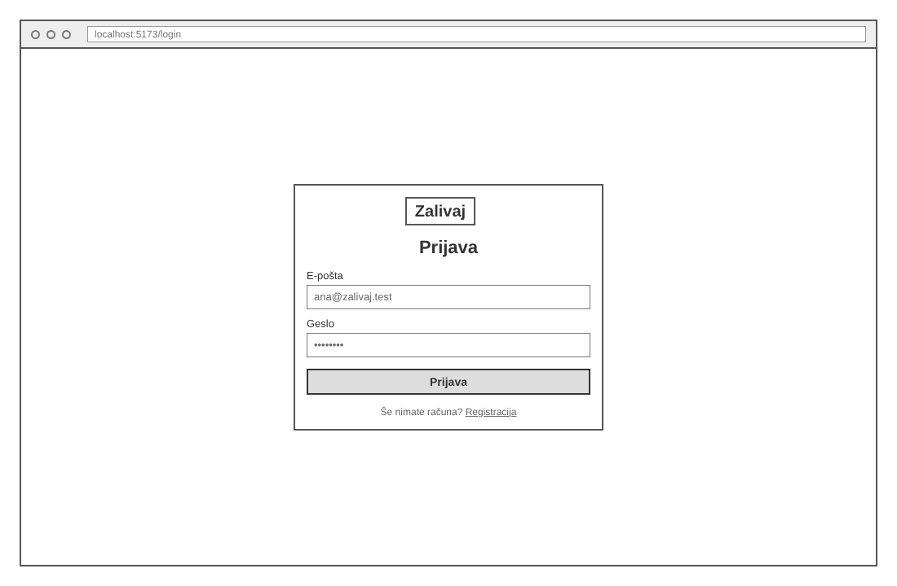
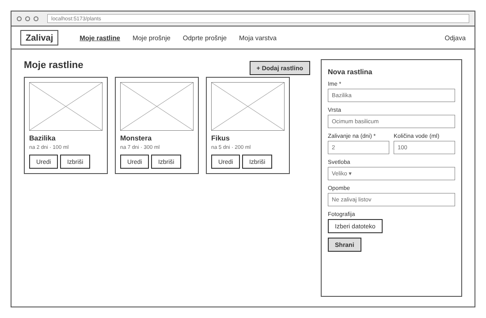
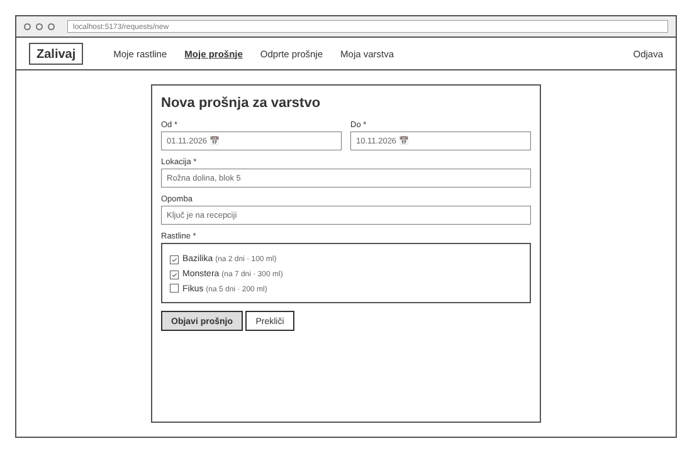
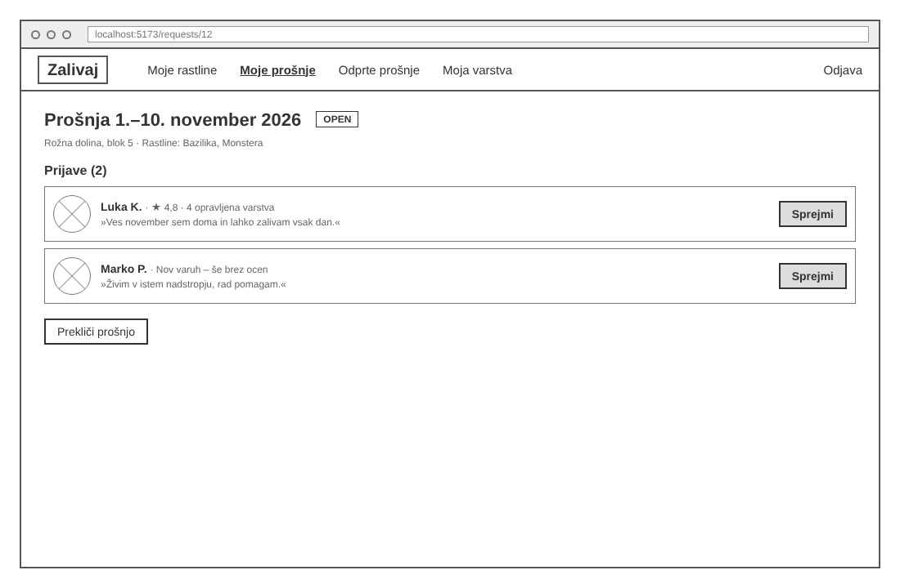
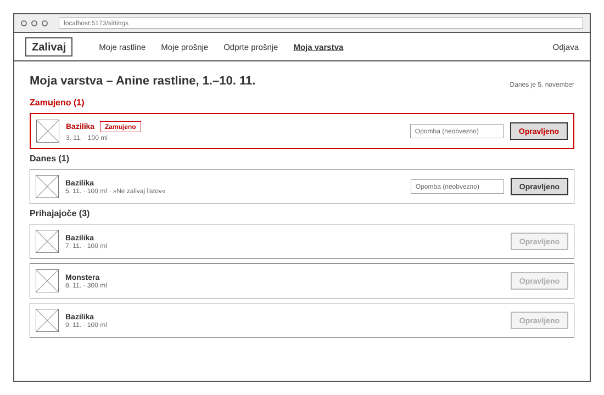

# 06 – Wireframes

Spodnji wireframe-i z nizko ločljivostjo prikazujejo osnovno postavitev glavnih zaslonov prve delujoče različice (MVP) rešitve Zalivaj. Prikazujejo strukturo in vsebino posameznega zaslona, ne končnih barv ali oblikovanja. Slike so v mapi [`wireframes/`](wireframes/).

## WF-01 – Prijava

Zaslon za prijavo s polji za e-pošto in geslo, gumbom "Prijava" in povezavo do registracije. Je vstopna točka za lastnike, varuhe in administratorja. *Povezana zgodba: US-01.*

## WF-02 – Moje rastline

Lastnikov seznam rastlin. Vsaka kartica prikazuje fotografijo, ime rastline, pogostost zalivanja in količino vode ter gumba "Uredi" in "Izbriši". Desno je obrazec za dodajanje nove rastline; ime in pogostost zalivanja sta obvezna. *Povezana zgodba: US-02.*

## WF-03 – Nova prošnja za varstvo

Obrazec za ustvarjanje prošnje za varstvo. Lastnik vnese začetni in končni datum, lokacijo in opombo ter izbere, katere svoje rastline vključuje prošnja. "Objavi prošnjo" jo shrani s statusom OPEN. *Povezana zgodba: US-03.*

## WF-04 – Prošnja in prijavitelji

Lastnikov pogled ene odprte prošnje. Pod datumi, lokacijo in rastlinami je seznam prijav. Vsaka prikazuje ime varuha, oceno zaupanja in sporočilo ter gumb "Sprejmi". Lastnik lahko prošnjo tudi prekliče. *Povezane zgodbe: US-05, US-06, US-12, US-13.*

## WF-05 – Nadzorna plošča varuha

Varuhov urnik zalivanja za aktivno varstvo, ki se je samodejno ustvaril ob sprejemu varuha. Opravila so razdeljena na Zamujeno (rdeče), Danes in Prihajajoče. Varuh lahko doda neobvezno opombo in klikne "Opravljeno"; pri prihodnjih opravilih je gumb onemogočen. *Povezane zgodbe: US-07, US-08, US-09.*
